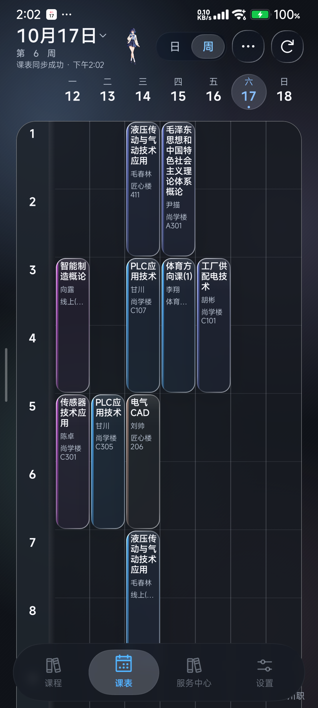
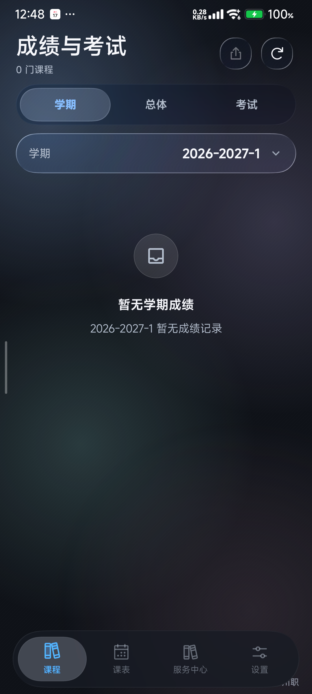
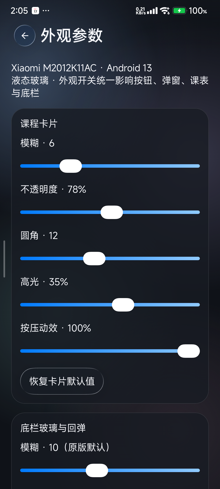
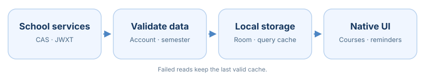

<div align="center">

<h1>Lumen Timetable</h1>
<p>Timetables, grades, exams and credits for SCVTC students.</p>

[](https://github.com/zwwd1/lumen-timetable/releases/latest)


[简体中文](README.md) · [English](README.en.md)

**[Download](#download) · [Screenshots](#screenshots) · [Features](#features) · [Quick Start](#start) · [Build](#build) · [Documentation](#docs)**
</div>

Lumen brings together timetables, grades, exam schedules and credit information for students at Sichuan Vocational and Technical College. It shows saved records first and lets you refresh when needed. If the current semester has no grades yet, you can still browse earlier records.

This is an unofficial adaptation of the campus Next app, maintained by zwwd1. Course editing, reminders and home-screen widgets are also included. For a timetable-focused app, see [Gnomon](https://github.com/zwwd1/gnomon-timetable). The two apps store their accounts and records separately.

<details>
<summary><strong>Contents</strong></summary>

- [Download & Installation](#download)
- [Screenshots](#screenshots)
- [Features](#features)
- [Quick Start](#start)
- [Appearance & Daily Use](#appearance)
- [Data & Privacy](#privacy)
- [Implementation & Build](#build)
- [Maintenance](#maintenance)
- [FAQ](#faq)
- [Documentation](#docs)
- [Attribution & Licenses](#credits)

</details>

---

<a id="download"></a>

## Download & Installation

| Variant | Purpose and architecture | Get it |
| :--- | :--- | :--- |
| **campus · 1.2.16** | Daily school use; this release is **ARM64** | [APK](https://github.com/zwwd1/lumen-timetable/releases/download/v1.2.16/Lumen-Timetable-1.2.16.apk) · 17.65 MiB |
| **platform** | Adds Gecko, ONNX and models for third-party extensions requiring an embedded browser | [Build from source](#build); not attached to this release |

[SHA-256](https://github.com/zwwd1/lumen-timetable/releases/download/v1.2.16/Lumen-Timetable-1.2.16.apk.sha256) · [Build provenance](https://github.com/zwwd1/lumen-timetable/releases/download/v1.2.16/BUILD_PROVENANCE.json) · [Matching source](https://github.com/zwwd1/lumen-timetable/tree/4eebde84a44cef042db1fa689b254061ebab6e3b) · [Release history](https://github.com/zwwd1/lumen-timetable/releases)

Choose **campus** for normal use. It uses system WebView and keeps the school timetable, grades, credits, official authentication, editing, reminders, widgets and AI. Other architectures require your own build.

The variants share a package ID and data format. Switching or updating in place requires matching signatures and an eligible version. A self-signed build cannot directly update an official project release signed with a different certificate.

---

<a id="screenshots"></a>

## Screenshots

<table><tr>
<td align="center"><br><b>Timetable</b><br>Day/week views and course details.</td>
<td align="center"><br><b>Grades and exams</b><br>Switch between semesters and overall results.</td>
<td align="center"><br><b>Materials and motion</b><br>Refraction, dispersion and spring controls.</td>
</tr></table>

Captured on **2026-10-17, Redmi K40 / Android 13, Lumen 1.2.14**. The images do not show accounts, credentials or personal grades.

---

<a id="features"></a>

## Features

| School information | Local data and sync | Appearance and extensions |
| :--- | :--- | :--- |
| Day/week timetable and editing | Cached results shown first | Glass titles that collapse on scroll |
| Grades, semesters and exam schedules | Records scoped by account and semester | Refraction, dispersion and springs |
| Credits and actual graduation requirements | Background attempts and manual refresh | Reduced motion and campus companion |
| Reminders and home-screen widgets | CSV / ICS / HTML import and export | User-configured AI; optional platform extensions |

[Version 1.2.16](release-notes/v1.2.16.md) restores shared scrolling glass headers to Today, credits, sync, appearance, files and login, while retaining keyboard avoidance.

---

<a id="start"></a>

## Quick Start

1. Use the first-run invitation to connect with your school ID and school password. Credentials are remembered with local encryption.
2. Open the timetable and check the semester start date and period times in timetable settings.
3. Open **Courses → Grades & Exams** for semester, overall and exam information; **Credits** separates earned credits from requirements actually returned by the school.
4. Review the saved time and error state for each service on the sync page. Existing records remain available when a request fails.
5. Use Settings to export CSV, ICS or HTML. Imports show a preview before confirmation.

Ordinary expired sessions can be restored automatically where the school permits it. CAPTCHA or additional security checks must still be completed by the student in the official authentication page. See the [illustrated guide](docs/SCVTC_USAGE.md).

---

<a id="appearance"></a>

## Appearance & Daily Use

Settings provides course-card, bottom-bar blur, refraction, dispersion, spring and companion controls. Liquid Glass has its own appearance switch. Effects are not locked out by an old device model; the app follows system animation settings.

The background task attempts updates on a two-hour cycle, but Android, power, network and vendor restrictions affect when it runs. Refresh manually when current information is needed.

---

<a id="privacy"></a>

## Data & Privacy

School authentication and queries connect directly to school services. Passwords and recoverable sessions are encrypted locally using Android Keystore-managed keys. Normal course exports do not include school credentials.

Ordinary course records are stored in the app's private Room database, protected by the app sandbox and Android device-storage encryption; they are not encrypted field by field. Upstream cloud sync and anonymous statistics are paused. AI requires a user-configured service; selected online features can still make network requests. School credentials are not sent to the maintainer or AI providers. See the [privacy document](docs/SCVTC_PRIVACY.md).

---

<a id="build"></a>

## Implementation & Build

Kotlin / Compose renders the native UI. School authentication lives in `cn/scvtc/campus`, sync and projections in `com/tyust/course/scvtc`, and shared validation rules in `school-core`. Account, semester and completeness checks precede Room writes.



Prepare **JDK 21 and Android SDK 37**, configure `JAVA_HOME` and `ANDROID_HOME`, and use the repository's Gradle Wrapper:

```powershell
git clone https://github.com/zwwd1/lumen-timetable.git
cd lumen-timetable
.\gradlew.bat :app:assembleCampusRelease
# Optional full extension platform
.\gradlew.bat :app:assemblePlatformRelease
```

Use tag `v1.2.16` for the source matching this release. Platform-specific code and models are under `app/src/platform`. Original signing material is kept outside the repository. See [architecture and build](docs/SCVTC_ARCHITECTURE.md) and [platform release requirements](spec/PLUGIN-PLATFORM-RELEASE.md).

---

<a id="maintenance"></a>

## Maintenance

This is a personal project with no fixed update schedule. Changes to the school's login or data services may temporarily break some features. If you run into a problem, open an issue with your app version, device and steps to reproduce it. You are also welcome to fork the source.

The 1.2.16 release was checked against its build records and tested as an in-place upgrade on **Redmi K40 / Android 13**. Fresh installs, all ROMs, prolonged Doze/reboot scheduling, notification delivery and continuous widget updates are not comprehensively covered. See [VERIFICATION.md](VERIFICATION.md) and [BUILD_PROVENANCE.json](BUILD_PROVENANCE.json) for the recorded checks. 

---

<a id="faq"></a>

## FAQ

<details>
<summary><strong>Should I uninstall before updating?</strong></summary>

No. Use a matching-signature project release with an eligible version to update in place. If a signature mismatch occurs, check the source first. Uninstalling or clearing data loses local keys, so copied encrypted files cannot restore the old login.

</details>

<details>
<summary><strong>Does Lumen share its account or timetable with Gnomon?</strong></summary>

The apps can coexist, but maintain separate data spaces. Choose whichever workflow fits; accounts and records are not automatically shared.

</details>

---

<a id="docs"></a>

## Documentation

The [documentation directory](docs/README.md) groups usage, privacy, development and historical notes. Most detailed guides are currently in Chinese.

| Task | Read |
| :--- | :--- |
| Connect to school and use the app | [Illustrated guide](docs/SCVTC_USAGE.md) |
| Read release changes | [1.2.16 notes](release-notes/v1.2.16.md) · [Release history](https://github.com/zwwd1/lumen-timetable/releases) |
| Understand data flow and build | [Architecture](docs/SCVTC_ARCHITECTURE.md) · [Platform release requirements](spec/PLUGIN-PLATFORM-RELEASE.md) |
| Check privacy and acceptance | [Privacy](docs/SCVTC_PRIVACY.md) · [Verification](VERIFICATION.md) |
| Trace upstream sources and licenses | [Original README](docs/UPSTREAM_README.md) · [Source notices](SCVTC-NOTICES.md) |

---

<a id="credits"></a>

## Attribution & Licenses

Lumen is based on [zhengfang-apk](https://github.com/znjhahaha/zhengfang-apk), with school adaptation maintained by **zwwd1**. Original licenses and attribution are preserved in [LICENSE](LICENSE), [SCVTC-NOTICES.md](SCVTC-NOTICES.md) and the [OpenWakeUp license](LICENSE-OpenWakeUp-AGPL-3.0). Thanks to the upstream projects, Miuix, AndroidLiquidGlass and other component maintainers.
