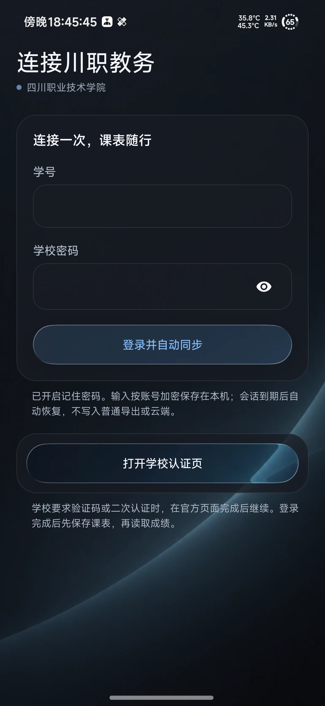
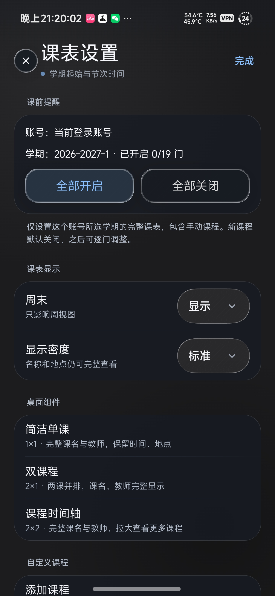
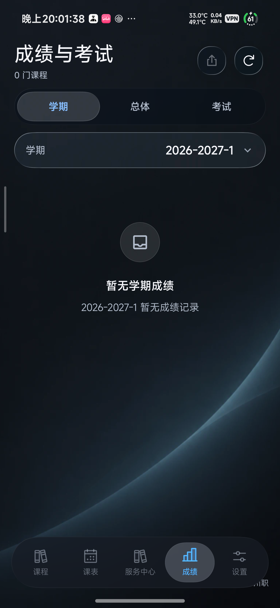

# Lumen 课程表

智慧川职有些地方用着实在别扭。查课表、找成绩，看起来都是很小的事，点来点去却挺磨人。我想把这些东西放得顺手一点，于是折腾出了 Lumen 课程表。

这是自己随心而动的作品，希望能帮到川职院的同辈。它沿用川职 Next 的课程和插件架构，把课表、成绩、考试、学分与校园服务放在一起；比 Gnomon 更侧重教务信息，已经读到的内容也能离线看。

我不会实时维护，更新要看时间和精力。学校以后改登录方式或接口，应用可能会失效，也不保证立刻有人修。遇到了可以自己 fork，自行 vibe coding；源码和构建方法都留着，想怎么改就动手试试。

[下载 APK](https://github.com/zwwd1/lumen-timetable/releases/latest) · [反馈问题](https://github.com/zwwd1/lumen-timetable/issues) · [更新记录](release-notes/v1.2.7.md)

## 看图上手





[图文使用说明](docs/SCVTC_USAGE.md) 从首次登录开始，说明课表设置、成绩切换、外观和后台同步。截图来自 10 月 10 至 12 日的用户手机与实机调试，早于本次英文改名与使用指南更新。

## 能做什么

首次安装会邀请你登录川职教务。输入学号与学校密码，应用在后台建立学校会话并核验身份；通过后便返回应用，课表先保存，其他服务随后读取。等待中可以取消或转到官方页面。密码在本机按账号加密记住，登录过期后尝试自动恢复；验证码与账号安全提示在学校页面完成。

课表支持离线查看、手动编辑、课前提醒和桌面组件。成绩先显示本机缓存；学校返回的一份成绩按学期在本地切换，不重复读取整份报告。学分页展示已获学分与学校实际返回的毕业要求。选课、评教等提交业务仍在学校官方页面确认。

外观使用统一的玻璃组件，浅、深主题都有简洁的留白背景。可以换壁纸、调整玻璃参数、开关启动入场动画，并增减底栏中的首页、课表、成绩和服务入口。小澄有待机、思考与招呼状态，AI 对话使用你自己配置的模型服务。

[使用方法](docs/SCVTC_USAGE.md)

## 两个项目，侧重不同

[Gnomon 课程表](https://github.com/zwwd1/gnomon-timetable) 从课表出发，保留 SleepDown 的课程与作息体验；Lumen 课程表把课表和更多教务服务连接起来。两者各自保存本机数据，云服务暂停。

## 实现

`cn/scvtc/campus` 负责学校认证和教务接口，`com/tyust/course/scvtc` 负责同步、服务入口与数据投影，`school-core` 维护课程和导入规则。学校返回的数据校验后写入 Room，再交给原生页面展示。同步合并学校变更时保留用户编辑，查询失败保留缓存。

密码和会话由 Android Keystore 与 AES-GCM 保护；成绩、查询记录按账号加密，普通课表导出不带凭据。AI 课程授权默认关闭，云服务和匿名统计暂停。

[构建原理](docs/SCVTC_ARCHITECTURE.md) · [隐私说明](docs/SCVTC_PRIVACY.md)

## 安装与构建

日常使用下载默认的川职包：课表、成绩、学分、官方认证、编辑、提醒、组件和 AI 均保留。它使用系统 WebView 连接学校，不再携带另一套浏览器内核。

需要第三方嵌入浏览器扩展时，下载文件名含 `platform` 的完整插件平台包。Gecko、ONNX 和原模型仍在这个包中；它与川职包使用相同包名、原签名和数据格式，可以覆盖切换。应用内更新会保留当前包的类型。两种分发均提供 ARM64 与通用包；同一分发内功能相同，不确定机型时选通用包。

使用 JDK 21、Android SDK 37.0 与仓库中的 Gradle Wrapper：

```powershell
.\gradlew.bat :app:assembleCampusRelease
# 完整插件平台包
.\gradlew.bat :app:assemblePlatformRelease
```

构建会输出各架构 APK 与通用包。专用内核、推理代码和模型位于 `app/src/platform`；本校页面与系统 WebView 认证共用 `app/src/main`。正式更新沿用第一版包名和签名；自行签名的包不能覆盖正式版。密钥留在仓库外，见构建说明。完整插件平台保留 [平台一致性检查](spec/PLUGIN-PLATFORM-RELEASE.md)。

[GitHub Release](https://github.com/zwwd1/lumen-timetable/releases) 提供安装包、源码标签与 SHA-256。[验证记录](VERIFICATION.md) 说明完成了哪些检查，哪些仍待手机确认。

## 致谢项目

川职 Next、Miuix、AndroidLiquidGlass，以及浏览器、地图和模型组件的开源维护者。源码与第三方组件许可见 [LICENSE](LICENSE) 和 [SCVTC-NOTICES.md](SCVTC-NOTICES.md)。
