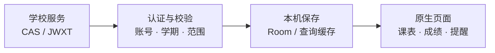

<div align="center">

<h1>Lumen 课程表</h1>
<p>课程、成绩和考试，少绕几次路。</p>

[](https://github.com/zwwd1/lumen-timetable/releases/latest)


[简体中文](README.md) · [English](README.en.md)

**[下载 APK](#download) · [界面预览](#screenshots) · [功能总览](#features) · [快速上手](#start) · [常见问题](#faq) · [文档索引](#docs)**
</div>

智慧川职用起来有时真挺磨人。只是想看课表、查成绩，却要点来点去。我按自己的习惯折腾了 Lumen，把常用的教务信息放在一起。这是自己随心而动的作品，希望能帮到川职院的同辈。

这是川职 Next 的非官方适配版，由 zwwd1 维护。它更侧重教务查询；如果更喜欢课程编辑、作息和提醒，可以看看 [Gnomon 课程表](https://github.com/zwwd1/gnomon-timetable)。两款各自保存数据，选一款顺手的就行。

<details>
<summary><strong>目录</strong></summary>

- [下载与安装](#download)
- [界面预览](#screenshots)
- [功能总览](#features)
- [快速上手](#start)
- [外观与日常设置](#appearance)
- [Gnomon 与 Lumen 怎么选](#compare)
- [数据与隐私](#privacy)
- [实现与构建](#build)
- [维护与验证](#maintenance)
- [常见问题](#faq)
- [文档索引](#docs) · [来源与许可](#credits)

</details>

---

<a id="download"></a>

## 下载与安装

| 方案 | 用途与架构 | 获取方式 |
| :--- | :--- | :--- |
| **campus · 日常版 1.2.16** | 川职查询与日常课表；本次发布为 **ARM64** | [下载 APK](https://github.com/zwwd1/lumen-timetable/releases/download/v1.2.16/Lumen-Timetable-1.2.16.apk) · 17.65 MiB |
| **platform · 扩展平台** | 额外包含 Gecko、ONNX 与模型，用于需要嵌入浏览器的第三方扩展 | [自行构建](#build)，本次发行未附此包 |

[SHA-256 校验](https://github.com/zwwd1/lumen-timetable/releases/download/v1.2.16/Lumen-Timetable-1.2.16.apk.sha256) · [构建来源](https://github.com/zwwd1/lumen-timetable/releases/download/v1.2.16/BUILD_PROVENANCE.json) · [对应源码](https://github.com/zwwd1/lumen-timetable/tree/4eebde84a44cef042db1fa689b254061ebab6e3b) · [历史版本](https://github.com/zwwd1/lumen-timetable/releases)

日常使用选择 **campus** 即可：使用系统 WebView，保留本校课表、成绩、学分、官方认证、编辑、提醒、组件及 AI。其他设备架构需自行构建。

> [!NOTE]
> campus 与 platform 共用包名、签名和数据格式，符合版本与原签名要求时可覆盖切换。自行换签名的构建不能直接覆盖正式包。

---

<a id="screenshots"></a>

## 界面预览

<table><tr>
<td align="center"><br><b>课表</b><br>日 / 周切换，点课程看详情。</td>
<td align="center"><br><b>成绩与考试</b><br>本学期未出分，可看往期与总体。</td>
<td align="center"><br><b>材质与动效</b><br>折射、色散、回弹及入场由你调整。</td>
</tr></table>

以上拍摄于 **2026-10-17，Redmi K40 / Android 13，Lumen 1.2.14**。不展示账号、密码与个人成绩。

---

<a id="features"></a>

## 功能总览

| 课程与教务 | 同步与数据 | 外观与扩展 |
| :--- | :--- | :--- |
| 日 / 周课表、课程详情和编辑 | 本机缓存优先显示 | 滚动收放的玻璃标题 |
| 成绩、学期与考试安排 | 按账号、学期和服务保存 | 折射、色散和弹簧参数 |
| 学分概况与实际毕业要求 | 后台尝试更新、手动刷新 | 减少动态效果与校园助手 |
| 课程提醒和桌面组件 | CSV / ICS / HTML 导入导出 | 自行配置的 AI 与可选 platform 扩展 |

[1.2.16 更新](release-notes/v1.2.16.md)：今天、学分、教务同步、外观、文件和登录页接回滚动玻璃标题；上滑收起，下拉展开，保留透明模糊与键盘避让。

---

<a id="start"></a>

## 快速上手

| 步骤 | 操作位置 | 说明 |
| --- | --- | --- |
| ① 登录 | 首次连接邀请 → 川职学号与学校密码 | 密码在本机加密记住，后续尝试自动恢复会话 |
| ② 看课表 | 底栏 **课表** | 设置 → 当前课表详情设置，核对开学日期与节次时间 |
| ③ 查成绩 | **课程** → **成绩与考试** | 学期 / 总体 / 考试分别查看；已有记录先显示缓存 |
| ④ 查学分 | **课程** → **学分概况** | 区分已获学分与学校实际返回的毕业要求 |
| ⑤ 导出 | 设置 → **CSV / ICS / HTML** | 选择格式和保存位置；导入先预览再确认 |

学校要求验证码或安全确认时，在应用的**官方认证页**完成后继续。普通会话到期会尝试后台恢复；换手机、清数据、改密码或强制人工验证时仍需本人处理。[完整操作说明](docs/SCVTC_USAGE.md)

---

<a id="appearance"></a>

## 外观与日常设置

设置 → **卡片、动效与校园助手**可调课程卡、底栏模糊、折射、色散和弹簧力度，也可开关入场、减少动态效果及小澄。液态玻璃总开关在设置 → 外观。**不按旧机型号锁定效果**；系统关闭动画时，应用仍会遵循。

两小时周期的后台任务会尝试更新，Android 和手机后台限制会影响执行时间。需要最新信息时手动刷新。教务同步页分别显示认证、课表、成绩等服务的保存时间和错误；失败保留缓存。

---

<a id="compare"></a>

## Gnomon 与 Lumen 怎么选

| 你更常做什么 | 本仓库：Lumen | [Gnomon](https://github.com/zwwd1/gnomon-timetable) |
| :--- | :--- | :--- |
| 集中查看教务 | 课表、成绩、考试、学分和校园服务 | 课表与常用成绩查询 |
| 安排上课日常 | 保留编辑、提醒和桌面组件 | 更侧重课程编辑、作息与提醒 |
| 使用已有记录 | 查询结果本机缓存 | 课表离线可看 |

选一款顺手的即可，也可以同时安装。两款使用各自的数据空间，不会自动共享账号和课表。

---

<a id="privacy"></a>

## 数据与隐私

学校认证与查询直接访问学校服务。密码和可恢复会话使用 Android Keystore 管理的密钥加密保存在本机，普通课程导出不携带学校凭据。

课程与作息保存在应用私有 Room 数据库，由应用沙箱和 Android 设备存储加密保护。上游云同步与匿名统计暂停；AI 需自行配置，主动调用的服务仍可能联网。完整保护范围见[隐私说明](docs/SCVTC_PRIVACY.md)。

---

<a id="build"></a>

## 实现与构建

Kotlin / Compose 展示页面；川职认证在 `cn/scvtc/campus`，同步和页面投影在 `com/tyust/course/scvtc`，课程规则在 `school-core`。身份、学期和数据完整性校验通过后才写入 Room；网络或认证失败时保留最后成功的记录。



### 自行构建

准备 **JDK 21、Android SDK 37**，配置 `JAVA_HOME` 与 `ANDROID_HOME`，使用仓库的 Gradle Wrapper：

```powershell
git clone https://github.com/zwwd1/lumen-timetable.git
cd lumen-timetable
.\gradlew.bat :app:assembleCampusRelease
# 需要完整插件平台时
.\gradlew.bat :app:assemblePlatformRelease
```

两类构建共享学校认证与数据格式，扩展平台的专用实现和模型位于 `app/src/platform`。发布签名与配置保存在仓库外；具体要求见[构建原理](docs/SCVTC_ARCHITECTURE.md)及[平台发布约定](spec/PLUGIN-PLATFORM-RELEASE.md)。

复现当前正式包时使用版本标签 `v1.2.16`，也可直接查看[发行对应源码](https://github.com/zwwd1/lumen-timetable/tree/4eebde84a44cef042db1fa689b254061ebab6e3b)。自行签名不等于原签名覆盖升级。

---

<a id="maintenance"></a>

## 维护与验证

我不会实时维护，更新看时间和精力。学校以后换接口，应用可能会失效，也不保证能及时修。有需要就 fork，**自行 vibe coding**；源码和构建方法都留在这里。

### 已记录的验证范围

Lumen 1.2.16 的原签名构建、发布来源和 **Redmi K40 / Android 13** 覆盖升级已有记录，保留既有数据完成了部分核心页面检查。新装、所有 ROM、Doze / 重启后的长时后台、通知与组件持续更新等仍有未覆盖项，具体以 [VERIFICATION.md](VERIFICATION.md) 和 [BUILD_PROVENANCE.json](BUILD_PROVENANCE.json) 为准。

---

<a id="faq"></a>

## 常见问题

<details>
<summary><strong>已有账号和课表，升级需要卸载吗？</strong></summary>

无需先卸载。使用本项目原签名、满足版本要求的正式包覆盖安装；签名不一致时先核对来源。卸载或清数据会丢失本机密钥，不能靠复制加密文件恢复登录。

</details>

<details>
<summary><strong>为什么还会要求学校验证码或重新认证？</strong></summary>

应用会尝试恢复普通过期会话；学校要求验证码、安全确认或其他本人操作时，仍需在官方认证页完成。失败时保留离线记录，不要反复提交密码。

</details>

<details>
<summary><strong>为什么后台同步不是准点发生？</strong></summary>

Android、电量、网络和厂商后台限制会影响调度。已有课程可从本机读取，需要最新教务信息时手动刷新。设置与故障处理见[图文上手](docs/SCVTC_USAGE.md)。

</details>

---

<a id="docs"></a>

## 文档索引

| 想了解什么 | 阅读入口 |
| :--- | :--- |
| 登录、课表与教务操作 | [图文上手](docs/SCVTC_USAGE.md) |
| 本版改动与历史版本 | [1.2.16 更新说明](release-notes/v1.2.16.md) · [全部发行记录](https://github.com/zwwd1/lumen-timetable/releases) |
| 认证、缓存与构建 | [构建与数据流程](docs/SCVTC_ARCHITECTURE.md) |
| campus / platform 差异与发布 | [平台发布约定](spec/PLUGIN-PLATFORM-RELEASE.md) |
| 数据保存与实际验证 | [隐私说明](docs/SCVTC_PRIVACY.md) · [验证记录](VERIFICATION.md) |
| 项目来源与许可 | [原项目介绍](docs/UPSTREAM_README.md) · [LICENSE](LICENSE) · [来源说明](SCVTC-NOTICES.md) |

---

<a id="credits"></a>

## 来源与许可

本项目是川职 Next 的非官方适配版，由 **zwwd1** 维护。原生工程基于 [zhengfang-apk](https://github.com/znjhahaha/zhengfang-apk)，相关移植和组合代码的来源及许可见 [SCVTC-NOTICES.md](SCVTC-NOTICES.md)、[LICENSE](LICENSE) 与 [OpenWakeUp 许可](LICENSE-OpenWakeUp-AGPL-3.0)。感谢上游、Miuix、AndroidLiquidGlass 及其他组件维护者。
