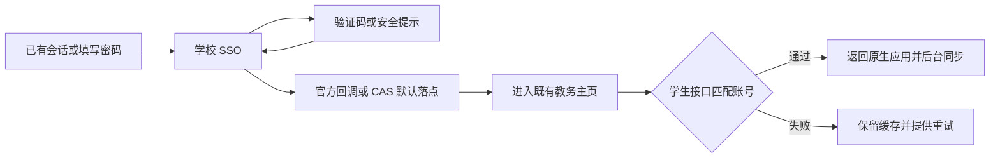

# 1.2.7 认证与教务导航

本次处理 2026-10-12 资料包所示的两版认证等待、旧版官网白屏及菜单退出，以及新版停在 CAS“应用”页的问题。原始截图和资料包留在私有工作区，不随源码发布。

## 已确认的链路

新版“返回教务首页”实际调用 `ScvtcWebSession.navigate(School.HOME)`，两版共享的 `School.HOME` 指向工程已有的教务学生主页入口。本次复用这个入口，没有另造图05地址或保存临时 ticket。用户提供了该菜单能抵达图05的事实；未从手机采集最终重定向记录，不能把源代码目标当作手机最终 URL 的抓包证据。

2026-10-12 匿名 GET 获取的[学校 H5 脚本](https://cas.scvtc.edu.cn/cas/H5/js/app.504fa629.js)将 `personCenter` 用作默认落点。当前自动流程只等待教务域，没有接上 CAS 内部 hash 路由变化；原状态识别还把登录后的落点归入安全提示。这是源码与公开资源能确认的缺口，截图本身不证明教务 Session 已建立。

## 实际修改

- CAS 的已知默认落点通过受限消息通知宿主，进入与菜单相同的教务主页。每次认证至多自动交接一次；验证码、绑定、安全设置与可见提示弹层留在官方页面。“一网通办”是主动浏览入口，不被自动拉回。
- 只有匹配的真实学生接口能完成身份确认。进入教务域后，即使页面跳转已使“点击提交”的 JavaScript 回调丢失，也继续核验身份，不再把该回调当作唯一前置条件。
- 后台认证文档在应用前台时挂入真实窗口，保持不可见、不接收输入，也不进入无障碍焦点。旋转移动同一文档；退出前台时解除窗口持有。没有添加悬浮窗权限。无前台窗口时仍使用应用持有的有界认证流程，实际后台表现待手机确认。
- 认证脚本的延后回调在取消或关闭页面时撤销，关闭后不再操作已销毁 WebView。
- 旧版认证菜单使用新版已有的窗口弹层，隔离官网页面与原菜单的整页背景捕获。没有取得崩溃堆栈，不能断言这种绘制差异就是手机闪退的唯一根因，也没有声称已实机复现。
- 旧版官网补齐加载、超时、重新打开、用户发起的新窗口、共享学校 Cookie 与缩放；新版渲染器退出后可重建网页，取消旧监听并重新绑定身份状态。

旧版此前没有安装进程异常记录器。现在保存脱敏 Java 堆栈，并在下次启动查询本应用的原生崩溃 / ANR 退出原因；不读取系统跟踪文件、异常消息、网页、账号密码或票据。没有 Java 堆栈时明确显示该限制，保留原异常处理链。

## 手机人工验收

1. 覆盖安装后先查看原课表、编辑、提醒、成绩与学分缓存。
2. 两版打开认证页，在网页未加载时、加载后分别打开三点菜单；确认可展开并回到教务主页。
3. 填写学校账号密码；学校要求的验证本人完成。确认不会长时间停在提交，登录后不再留在 CAS 默认“应用”页，自动进入同一教务入口。
4. 进入“一网通办”后确认保持门户浏览；返回教务、刷新、重新认证分别可用，没有重复跳转。
5. 认证中取消、转到官方页、旋转、退出前台；恢复后核对状态与账号没有串用。
6. 断网、学校服务不可用、认证失效时确认不清除既有课表、成绩和学分，恢复网络后再同步。
7. 若旧版再次异常退出，重开后复制本机报告；真正原因以新版本 mapping、堆栈或系统退出记录为准。

编译和产物记录见 [VERIFICATION.md](../VERIFICATION.md)。按会话约束未连接手机、未运行应用功能或自动化 UI 测试，未新增测试提交。公开资源检查没有输入账号密码或提交认证。源码判断与手机结果分别记录。

生命周期处理参考 [Android WebView 文档](https://developer.android.com/develop/ui/views/layout/webapps/managing-webview)。
