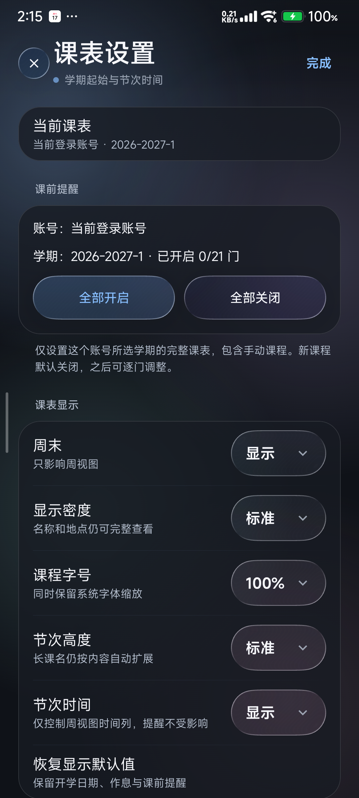

# Lumen 使用说明

配图拍摄于 2026-10-17，Redmi K40 / Android 13，Lumen 1.2.14。图中不含登录凭据与个人成绩。

## 1. 登录川职教务

新装且没有账号和记录时，首次邀请会引导连接川职。输入学号和学校统一认证密码，点“登录并自动同步”。密码在本机按账号加密保存，后续优先复用会话，过期时尝试恢复。

学校要求验证码、二次验证或账号安全确认时，在应用的“学校认证页”完成。换手机、清数据或改密码后需要重新连接；学校强制的人工验证也需要本人操作。

已有应用直接覆盖安装，保留数据；不要为了更新卸载。身份核验后先保存课表，成绩、考试和学分分别读取。

## 2. 课表与作息设置

底栏 **课表**查看一周安排，顶部切日 / 周和日期。点课程看完整名称、教师与教室；右上角三点菜单有同步、导出、添加、组件和课表设置。

到**设置 → 当前课表详情设置**，核对所选学期、开学日期和节次时间，再启用课前提醒。学校未提供节次时间时，请按实际作息填写；截图里的时间仅作示例。

“全部开启 / 关闭”只作用于当前账号所选学期的课程；新课提醒默认关闭。显示密度、课程字号和节次高度可分开调整，完整内容仍能在详情看见。

## 3. 成绩、考试与学分

从**课程 → 成绩与考试**进入，也可在外观参数中把成绩加入底栏。

- **学期**：按选定学期筛选已保存的完整记录。当前学期尚未出分会显示“暂无学期成绩”。
- **总体**：看累计记录与分布。当前学期为空，不代表往期成绩丢失。
- **考试**：查看学校已返回的考试安排；需要新数据时点右上角刷新。

切换和搜索使用本机缓存，不必反复请求整份报告。读取失败会保留已有内容，和“学校确认没有记录”分开显示。

**课程 → 学分概况**区分已获学分与毕业要求。未知数据不当作零，应用不代替学校认定毕业资格。

## 4. 外观设置

**设置 → 卡片、动效与校园助手**可调：

| 项目 | 作用 |
| --- | --- |
| 课程卡片 | 模糊、不透明度、圆角、高光、按压动效 |
| 底栏玻璃与回弹 | 模糊、折射、色散、高光、投影、弹簧力度 |
| 启动入场动画 | 关闭后直接显示首屏 |
| 减少动态效果 | 缩减页面运动；想保留完整过渡时关闭 |
| 底部导航入口 | 按需增减，设置固定保留，最多五项 |
| 小澄 | 显隐与大小，不影响课程或认证功能 |

液态玻璃总开关在设置 → 外观。完整参数不按旧机型号锁定。

**系统动画也会影响效果。**系统“动画时长缩放”为 0 时，应用会遵循。外观页显示当前状态并提供系统设置入口；想看完整过渡，将系统该项调至 1 倍。应用不会擅自改系统倍率。

## 5. 同步、文件与备份

**设置 → 教务同步与本机备份**分别列出认证、课表、成绩、考试和学分的状态与成功时间。某个服务失败，不代表其他服务也失败；先看对应条目，再定向重试。

后台任务按两小时周期尝试更新，Android 和手机的后台限制可能延后执行。需要最新信息时手动刷新。断网或学校故障保留缓存，失败提示可以重试。

**设置 → CSV / ICS / HTML**提供导入预览与导出。选择文件、确认预览后才保存，导出位置由系统文件选择器决定。普通课表导出不包含学校凭据。

AI 需要配置自己的模型服务，默认不附带课程信息。上游云同步与云恢复暂停；Lumen 和 Gnomon 各自保存数据。

## 常见问题

| 情况 | 处理 |
| --- | --- |
| 登录等很久 | 不要连续提交，可取消或转官方认证页，按页面提示处理 |
| 官方页显示 nginx / An error occurred | 先点右上角三点 → 返回教务首页；认证仍在时可直接继续，不必反复输密码 |
| 显示补充认证 | 在学校页面完成验证码或安全确认，再回来继续 |
| 有课表没成绩 | 核对学期，查看总体；必要时单独刷新成绩 |
| 网络恢复后仍提示失败 | 点重试；已有课表保留，不必清数据 |
| 后台没及时更新 | 检查联网、自启动与后台电量限制 |
| 换手机或改密码 | 重新建立这台手机的学校认证 |

反馈问题时请附版本、机型、复现步骤和相关错误，并隐藏账号、密码、Cookie 及个人成绩。维护安排见[项目首页](../README.md#maintenance)。

## 小米手机的后台同步

2026-10-17 的 Redmi K40 测试中，系统默认使用“智能限制后台运行”。如果后台更新经常延迟，可以长按桌面应用图标 → 应用信息，打开“自启动”；进入“电量消耗”，将省电策略改为“无限制”。不同系统的菜单名称可能不同。两款应用需要分别设置；取消电量限制可能增加耗电，可按需改回。即使开启，联网、认证状态和系统调度仍会影响更新时间。

Lumen 的教务同步页会显示系统已告知的后台限制，点提示可进入本应用设置；没有看到提示时，也可以按上面的路径手动检查。

[回到首页](../README.md) · [构建与数据流程](SCVTC_ARCHITECTURE.md) · [隐私说明](SCVTC_PRIVACY.md)
